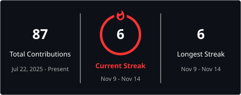

 

# ANUSHKA WAGHMODE

### Aspiring Software Development Engineer

---

## 👩‍💻 About Me

- 🎓 Pursuing B.E. in Computer Science Engineering (IoT & Cybersecurity).
- 💻 Aspiring Software Development Engineer.
- ☕ Interested in Java, backend development and problem-solving.
- 🌱 Currently learning **Spring Boot** and strengthening my DSA skills.
- 🚀 Exploring technologies and building software solutions.

---

## 🛠️ Tech Stack

**Languages**

**Frontend Development**

**Backend & Databases**

**Tools & Platforms**

---

---

## 📊 GitHub Statistics

## 📊 GitHub Statistics

---

## 🎓 Education

**B.E. — Computer Science Engineering**

Specialization: Internet of Things & Cybersecurity (including Blockchain Technology).

---

### Let's Connect!

